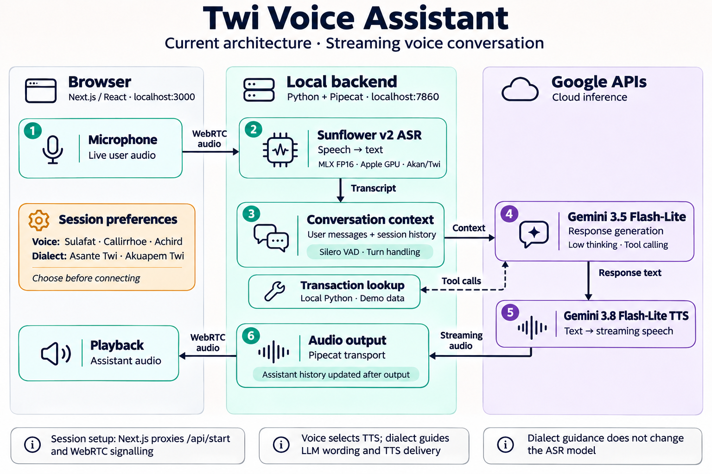

# Pipecat Twi Voice Assistant

A Pipecat voice assistant that supports English and Twi. It uses local Sunflower v2 ASR
for speech-to-text, a switchable Gemini or OpenAI LLM for responses and function calling,
and streaming Gemini speech with the Callirrhoe voice. Notevibes and remote Simba
remain selectable. Daily calls, DTMF input, and account tools are preserved.

## Architecture diagrams

These diagrams show the local browser setup before and after the latency improvements.
Daily calls, keypad input, and the additional account tools are also supported.



[Previous local architecture](docs/architecture/previous.png)

## Configuration

- **Bot type:** Web
- **Transport:** WebRTC
- **Pipeline:** Cascade
  - **STT:** Sunflower v2 ASR, MLX FP16 on Apple GPU; CPU INT8 option
  - **LLM:** Gemini 3.5 Flash-Lite for latency; Neon or OpenAI selectable
  - **TTS:** Gemini 3.8 Flash-Lite TTS streaming; Notevibes option
- **Features:** Live conversation, Silero VAD, Twi responses, transaction lookup,
  live metrics, behavioral evals, and Pipecat Cloud deployment

## Prerequisites

- Python 3.11-3.14
- [uv](https://docs.astral.sh/uv/)
- Node.js and npm
- API credentials:
  - `GEMINI_API_KEY` for Gemini, or `OPENAPI_KEY` for OpenAI
  - `GEMINI_API_KEY` also supplies streaming TTS
  - `NOTEVIBES_API_KEY` and `NOTEVIBES_VOICE_ID` only for Notevibes TTS
- Hugging Face access to `Sunbird/faster-whisper-51-african-languages` and a read token
- Microphone access in a browser

The local configuration targets Apple Silicon. Sunflower runs through MLX on the
GPU. Its 3.1 GB CTranslate2 checkpoint is downloaded once, then converted locally
to another approximately 3.1 GB MLX checkpoint. No additional weight download is
needed. `STT_ENGINE=faster-whisper` selects the original CPU INT8 path.

## Setup

Run the server and client in separate terminals.

### 1. Configure the server

```bash
cd server
cp .env.example .env
uv sync
```

Edit `server/.env` and set:

```dotenv
STT_LANGUAGE=aka
STT_ENGINE=mlx
HF_TOKEN=your-hugging-face-read-token
LLM_PROVIDER=gemini
GEMINI_API_KEY=your-gemini-api-key
GEMINI_MODEL=gemini-3.5-flash-lite
GEMINI_THINKING_LEVEL=low
TTS_PROVIDER=gemini
GEMINI_TTS_MODEL=gemini-3.8-flash-lite-tts
GEMINI_TTS_VOICE=Callirrhoe
```

Switch back to OpenAI by setting `LLM_PROVIDER=openai`, `OPENAPI_KEY`, and
optionally `OPENAI_MODEL` (default `gpt-4.1`). Gemini uses `GEMINI_MODEL`
(the example selects `gemini-3.5-flash-lite`; the code's legacy fallback is
`gemini-4-neon`) and `GEMINI_THINKING_LEVEL` (use `low` for the fast configuration).
Only the selected providers' keys are required. Restart `uv run bot.py` after
editing these settings. Providers never silently fall back.
Gemini's output allowance is 4,096 tokens, including thinking; the shared
system instruction keeps spoken responses brief.

[Gemini Neon documentation](https://aistudio.google.com/docs/models/gemini-4-neon).

Streaming Gemini TTS uses the existing Gemini key, detects the input text's
language, and emits audio as it arrives. The Gemini voice uses the same Callirrhoe
name, but its acoustic rendering may differ from Notevibes. Native-speaker voice
quality still needs listening validation.

In the web console, open **Voice** beside **Connect** to choose **Sulafat**
(warm, female), **Callirrhoe** (easy-going, female), or **Achird** (friendly, male).
The selected voice applies to the next session; end an active session before
changing it. The page starts with Callirrhoe and keeps your selection between
calls until you reload. This menu requires `TTS_PROVIDER=gemini`.
Voice choices travel in the start request's `body.voice` and only affect that
session; they never rewrite `.env`. Sessions without a choice use `GEMINI_TTS_VOICE`.

The adjacent **Twi dialect** menu switches between **Asante Twi** (initial selection)
and **Akuapem Twi**, independently of the voice. Select a dialect before connecting;
it stays selected between calls until the page reloads. `body.dialect` accepts
`asante` or `akuapem` and guides both the LLM's Twi wording and Gemini TTS delivery.
English replies remain available. Speech guidance is sent as style metadata, not
spoken text, and adds no extra model call. Sessions that omit the dialect keep the
original generic Twi behavior. This is prompt guidance, not a separate dialect model;
native-speaker listening is needed to assess pronunciation. Sunflower ASR is unchanged.

To use Notevibes again, set `TTS_PROVIDER=notevibes`, `NOTEVIBES_API_KEY`, and
`NOTEVIBES_VOICE_ID=ak-GH-Chirp3-HD-Callirrhoe`. Its adapter submits each speech
segment, polls for completion, then downloads the audio; this adds generation delay.
See the [Notevibes TTS API](https://notevibes.com/developer/docs/tts).

The `.env` file is git-ignored. Never commit real provider credentials.

### 2. Start the server

```bash
cd server
uv run bot.py
```

The Pipecat runner serves the WebRTC bot on `http://localhost:7860` by default.
Keep this process running while using the client or running eval scenarios.

Text evals exercise the selected LLM; audio evals additionally verify speech.

Sunflower access must be approved on the
[Sunbird model page](https://huggingface.co/Sunbird/faster-whisper-51-african-languages).
Set `HF_TOKEN` in `server/.env`, or run `uv run hf auth login` from `server/`.
Cache the checkpoint and convert it before starting the server:

```bash
cd server
HF_HUB_DISABLE_XET=1 HF_HUB_DOWNLOAD_TIMEOUT=60 uv run python - <<'PY'
from dotenv import load_dotenv
from huggingface_hub import snapshot_download
load_dotenv('.env', override=True)
snapshot_download(
    'Sunbird/faster-whisper-51-african-languages',
    revision='fcb165d5fa98b771e745ffcb0b8c886771038da9',
    allow_patterns=['model.bin', 'config.json', 'tokenizer.json', 'vocabulary.json', 'language_map.json'],
)
PY
uv run python scripts/convert_sunflower_mlx.py
```

The converter verifies the source SHA-256, tensor names and shapes, and preserves
Sunflower's learned encoder positions rather than regenerating standard Whisper
sinusoids. Output defaults to `~/.cache/twi-pipecat/sunflower-v2-mlx`; use
`--output` and `STT_MLX_MODEL_PATH` for another location. The local dev entry point
warms the model and GPU kernels before accepting calls. Other hosts that import
`bot()` directly can call `warm_stt_model()` once at process startup.

`STT_LANGUAGE=aka` selects Akan/Twi. Sunflower remaps Whisper's `jw` token
slot to Akan; that internal code does not mean this bot is transcribing Javanese.
Use `STT_LANGUAGE=eng` for English, then restart the server. Automatic language
detection is unsupported by this checkpoint, so mixed-language recognition is
not promised. The official faster-whisper conversion also differs from the
Transformers reference in input normalization; validate Twi recordings before
relying on transcription quality. There is no silent fallback to Whisper base.

Transcription runs sequentially for each speech segment. The turn controller
and STT metadata allow up to 60 seconds for pending transcripts, instead of
ending an apparently empty turn after five seconds. This is a conservative wait
budget, not a measured p99 or a fixed delay: the final transcript can trigger the
reply immediately. VAD thresholds remain at their defaults.

Measured on an M2 Max (2026-11-24): the same 3.26-second recorded Twi clip took
9.71 seconds with CPU INT8 and 0.73–0.85 seconds with warm MLX FP16. The final
headless speech round trip measured approximately 2.8 seconds from speech end
to first bot audio, using Flash-Lite and streaming Gemini TTS. These are scoped
sample measurements, not a latency guarantee or an accuracy benchmark. A second
large GPU transcription model in the eval harness caused contention; the final
round-trip scenario uses a small CPU judge transcriber instead.

To restore the earlier configuration, set `STT_ENGINE=faster-whisper`,
`GEMINI_MODEL=gemini-4-neon`, and `TTS_PROVIDER=notevibes`, then restart. Existing
Notevibes credentials and the selected voice are retained in the local env file.

### 3. Configure and start the client

```bash
cd client
npm install
cp env.example .env.local
npm run dev
```

Open `http://localhost:3000`.

The client uses SmallWebRTC, matching the server's `webrtc` transport.

The client sends connection requests to `/api/start`, which forwards them to
`http://localhost:7860/start` by default. The optional client environment
variables are:

```dotenv
BOT_START_URL=http://localhost:7860/start
BOT_START_PUBLIC_API_KEY=
```

Set `BOT_START_URL` to the public bot start endpoint when using a remote or
deployed server. Set `BOT_START_PUBLIC_API_KEY` only if that endpoint requires
Bearer authentication.

## How the bot works

The server builds a Pipecat cascade pipeline:

```text
WebRTC or Daily input
  -> DTMF aggregator
  -> local Sunflower v2 ASR (Akan/Twi)
  -> user context aggregator
  -> selected LLM (Gemini Flash-Lite, Neon, or OpenAI)
  -> streaming Gemini TTS (or Notevibes)
  -> WebRTC output
  -> assistant context aggregator
```

The `find_transaction` tool accepts a Twi or English transcript, extracts a
Cedis amount and Ghanaian phone number, and checks a demo transaction database.
It reports missing information, no match, or the transaction status to the LLM.
Demo transactions are loaded from `server/src/database/transactions.csv`; accounts
come from `server/src/database/accounts.csv`. The existing tools also support
transaction totals, account balances, account types, and user ID lookup. Replace
these demo data sources before production use.

## Existing phone and STT integrations

Set `STT_ENGINE=simba` and `SIMBA_STT_URL` to use the existing remote Simba service.
Daily transport and dial-in handlers remain available; configure `DAILY_API_KEY`
when using Daily. The LLM retains the upstream finance scope, bilingual greeting,
and keypad guidance. The local browser selectors require Gemini TTS.

## Testing with evals

The project includes behavioral eval scenarios. Scenarios drive the bot through
the Pipecat runner, so no live voice call is needed for the text-mode loop.

Start the bot in one terminal:

```bash
cd server
uv run bot.py
```

Run a scenario in a second terminal:

```bash
cd server
uv run pipecat eval run evals/smoke_text.yaml evals/transaction_text.yaml -v  # no judge
uv run pipecat eval run evals/sunflower_audio_input.yaml -v  # recorded Twi input, text reply
uv run pipecat eval run evals/sunflower_voice_roundtrip.yaml -v -a  # Twi input, spoken English reply
uv run pipecat eval run evals/starter_text.yaml -v  # requires a judge
uv run pipecat eval run evals/starter_audio.yaml -v
```

- Text mode is the fast loop for prompt behavior and function-call decisions.
- Audio mode exercises VAD, STT, TTS, and the full round trip.
- The starter audio scenario downloads local speech models on the first run.
- The Sunflower audio-input regression uses the included Notevibes-generated
  Callirrhoe recording and requires both speech segments plus a reply. It checks
  input audio and turn handling; it bypasses output TTS and does not establish
  Twi recognition accuracy.

Some eval assertions use a judge LLM. The scenario files default to local
Ollama with `gemma4:12b`:

```bash
ollama pull gemma4:12b
```

The eval files may instead be configured to use OpenAI or another supported
judge provider. Add scenarios under `server/evals/` as bot behavior changes.

## Project structure

```text
pipecat-twi/
├── server/
│   ├── bot.py                        # Main Pipecat worker and pipeline
│   ├── src/
│   │   ├── services/
│   │   │   └── notevibes_tts_service.py # Notevibes TTS implementation
│   │   └── tools/
│   │       └── transaction.py       # Demo transaction lookup tool
│   ├── evals/                        # Text and audio eval scenarios
│   ├── .env.example                  # Server environment template
│   ├── Dockerfile                    # Pipecat Cloud/container image
│   ├── pcc-deploy.toml               # Pipecat Cloud deployment settings
│   ├── pyproject.toml                # Python dependencies
│   └── uv.lock                       # Reproducible Python dependencies
├── client/
│   ├── src/app/                      # Next.js pages and /api/start route
│   ├── src/components/pipecat/       # Pipecat UI components
│   ├── src/hooks/                    # Client, metrics, and event hooks
│   ├── env.example                   # Client environment template
│   └── package.json                  # Node dependencies and scripts
└── README.md
```

## Building and testing the client

```bash
cd client
npm run dev
npm run lint
npm run build
npm run start
```

The client uses Next.js and the Pipecat UI console components. These components
live under `client/src/components/pipecat/` and may be edited directly.

## Deploying with Docker

The server Dockerfile uses `dailyco/pipecat-base:latest-py3.14`, syncs locked
dependencies, and copies `server/bot.py` and `server/src`.

Build and run from `server/`:

```bash
cd server
docker build -t twi-voice-assistant .
docker run --rm -p 7860:7860 \
  --env-file .env \
  twi-voice-assistant
```

When deploying outside Docker, inject the selected LLM API key and `NOTEVIBES_API_KEY` through the
host's secret manager rather than copying `.env` into an image.

## Deploying to Pipecat Cloud

This project includes `server/pcc-deploy.toml`:

```toml
agent_name = "twi-project"
secret_set = "twi-project-secrets"
agent_profile = "agent-1x"
```

Before deploying:

1. Create a Pipecat Cloud account and complete `pipecat cloud auth login`.
2. Put the server secrets in `server/.env`.
3. Create the configured secret set:

   ```bash
   cd server
   pipecat cloud secrets set twi-project-secrets --file .env --skip
   pipecat cloud deploy --yes
   ```

Do not include real credentials in `pcc-deploy.toml` or source control.

See the [Pipecat Cloud documentation](https://docs.pipecat.ai/pipecat-cloud/introduction)
for account setup and ongoing agent management.

## Security and production readiness

- Rotate provider credentials if they have ever been committed or shared.
- The transaction database is in-memory and contains demo data only.
- The bot can speak and act on unverified caller requests; add authentication,
  authorization, rate limits, redaction, and audit logging before production.
- Never collect or log PINs or other sensitive authentication credentials.

## Learn more

- [Pipecat Documentation](https://docs.pipecat.ai/)
- [Pipecat UI Documentation](https://ui.pipecat.ai/)
- [Pipecat GitHub](https://github.com/pipecat-ai/pipecat)
- [Pipecat Examples](https://github.com/pipecat-ai/pipecat-examples)
- [Pipecat Discord](https://discord.gg/pipecat)
